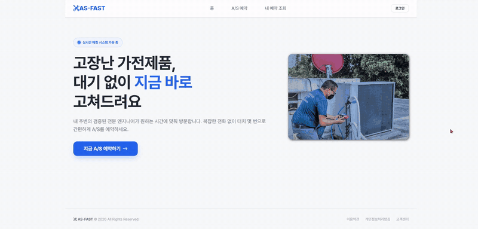

# 냉·난방 AS 실시간 예약 (AS-FAST)

회원이 냉·난방 AS를 **예약·조회·삭제하고 리뷰를 남기면**, 관리자가 접수 현황과 리뷰를 **대시보드로 확인**하는 예약 시스템입니다.
그린AI캠퍼스 1차 팀 프로젝트(COMMIT, 3인 · 2026.09.08 ~ 09.16)이며, 저는 팀장이었습니다.



> 로그인 → AS 예약(제품 · 일정 선택) → 예약 내역 조회 → 리뷰 작성 → 관리자 대시보드 순서의 시연입니다.

## 한눈에 보기

| | |
|---|---|
| 카테고리 통계 | 예약이 0건인 카테고리도 보이도록 `RIGHT OUTER JOIN`으로 건수 집계 |
| 리뷰 통계 | 전체 건수 · 평균 평점 · 별점별 개수를 **한 번의 쿼리**로 집계 |
| 예약 흐름 | 제품 → 일정 → 확정의 3단계 화면 (FullCalendar, axios 비동기) |
| 데이터 | `RESERVE` 테이블 중심으로 5개 테이블 연결 |

## 기술 스택

Java 17 · Spring Boot · MyBatis · Thymeleaf · MariaDB · JavaScript(axios) · FullCalendar 

## 구조

```
src/main/java/com/commit/project1
├─ member    회원 · 로그인
├─ reserve   예약 (Controller / Service / Mapper / DTO)
├─ review    리뷰
└─ admin     관리자 대시보드
src/main/resources
├─ mapper    MyBatis XML
├─ templates Thymeleaf (layouts / pages)
└─ static    CSS · JS
```

## 맡은 부분

- 메인 화면(예약일 표시) · 로그아웃, 예약 조회 · 시간 선택 화면
- **리뷰 도메인 전체**: DB 설계, Spring(Controller · Service · Mapper), 리뷰 작성 화면
- **관리자 대시보드 통계**: 예약 접수 건수, 카테고리별 건수, 리뷰 통계를 쿼리 한 번씩으로 집계
- 공통 UI 스타일(`common.css`, `reset.css`) 


## 핵심 코드

| 주제 | 위치 |
|---|---|
| 리뷰 통계 한 번에 집계 (`CASE WHEN` + `HashMap`) | [`review-mapper.xml`](src/main/resources/mapper/review-mapper.xml#L36) |
| 카테고리별 예약 건수 (`RIGHT OUTER JOIN`) | [`reserve-mapper.xml`](src/main/resources/mapper/reserve-mapper.xml#L177) |
| 관리자 대시보드 컨트롤러 | [`AdminController.java`](src/main/java/com/commit/project1/admin/controller/AdminController.java) |

```xml
<select id="selectStats" resultType="HashMap">
  SELECT COUNT(*) AS totalCount, ROUND(AVG(RATING), 1) AS avgRating,
         SUM(CASE WHEN RATING = 5 THEN 1 ELSE 0 END) AS star5,
         SUM(CASE WHEN RATING = 4 THEN 1 ELSE 0 END) AS star4,
         SUM(CASE WHEN RATING <= 3 THEN 1 ELSE 0 END) AS star3Below
  FROM REVIEW
</select>
```

`HashMap`으로 받아 DTO를 만들지 않은 대신 타입 안정성은 포기했습니다.

## 기록

- [프로젝트 작업 일지 (Notion)](https://fluffy-plane-19c.notion.site/3e3a969c48278070bbaaf5dee74b31b4)
